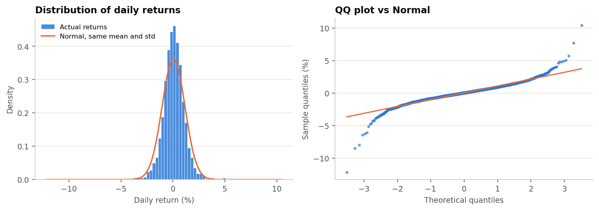
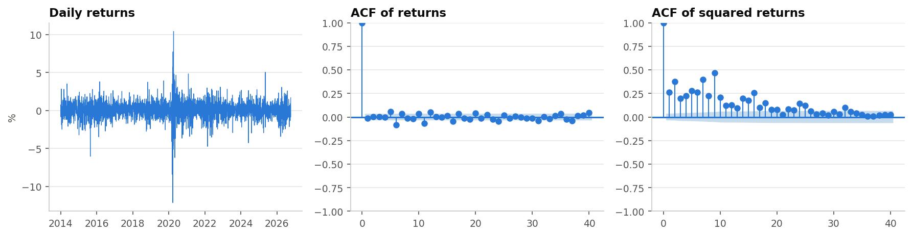
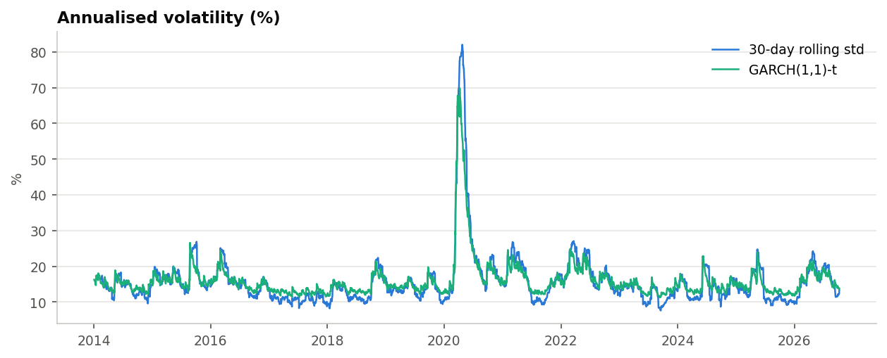
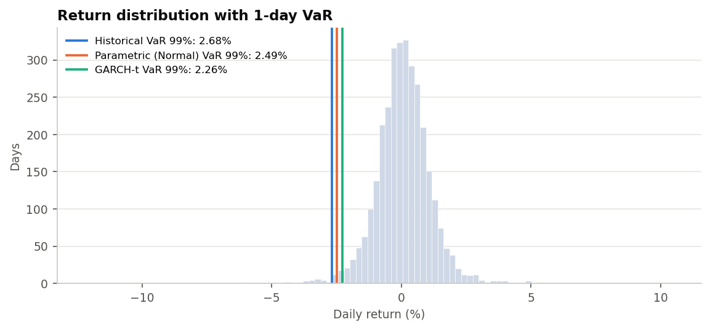
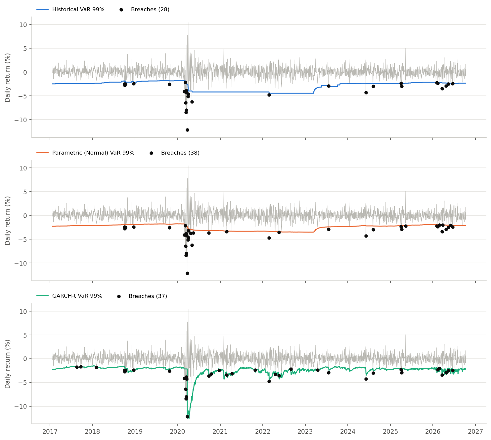
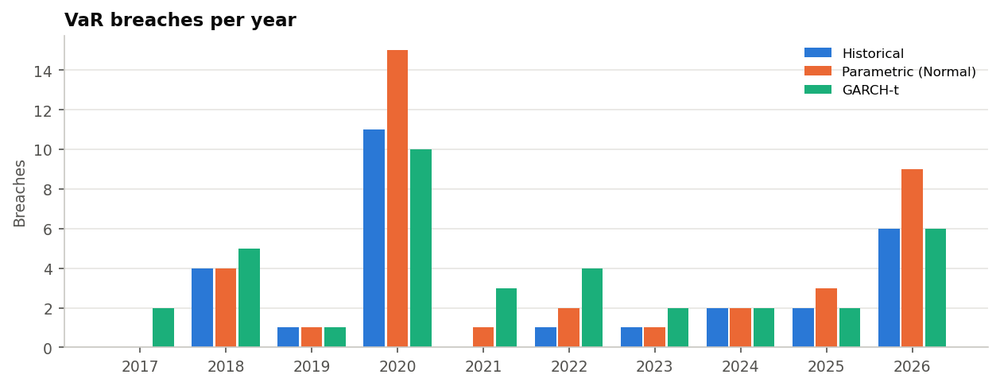

# Market Risk: GARCH Volatility, VaR and Expected Shortfall with Backtesting

Estimates one-day Value at Risk and Expected Shortfall for an Indian equity portfolio three ways
(Historical, Parametric Normal, GARCH(1,1) with Student-t errors) and **backtests** each with Kupiec,
Christoffersen and Basel traffic-light tests.

## Run
```
pip install -r requirements.txt
jupyter notebook market_risk_var_garch.ipynb     # Run All
streamlit run app.py
```
Prices come from yfinance and are cached in `data/prices.csv` (used automatically if a download fails).

## Files
- `riskkit.py` functions: data, stats, VaR/ES, GARCH, backtest, tests
- `market_risk_var_garch.ipynb` the analysis, with charts saved in `outputs/`
- `app.py` Streamlit app

## Method notes
- Returns are decimal simple returns; portfolio rebalanced daily to fixed weights.
- Backtest: 750-day rolling window, GARCH refit every 20 days, volatility filtered daily in between. Only past data is used for each day's VaR.
- Pass = Kupiec p > 0.05 and independence p > 0.05.

## Results

*Data: 1 Jan 2014 to 9 Oct 2026 (Yahoo Finance). Equal-weighted portfolio of Reliance, HDFC Bank, Infosys, TCS and ICICI Bank. Daily VaR numbers change as new data comes in.*

### Returns are not Normal

| Statistic | Value |
|---|---|
| Observations | 3,150 |
| Annualised volatility | 17.4% |
| Skew | -0.45 |
| Excess kurtosis | 12.25 |
| Worst / best day | -12.15% / +10.44% |
| Jarque-Bera p-value | 0.0000 |

Extreme days happen far more often than a Normal distribution predicts, and volatility clusters (ARCH-LM p-value 0.0000).




### GARCH(1,1) with Student-t errors

- alpha + beta = 0.974, so shocks fade slowly (half-life about 26.5 days)
- Student-t degrees of freedom = 7.2, confirming fat tails



### 1-day VaR and Expected Shortfall (99%)

| Method | VaR | Expected Shortfall |
|---|---|---|
| Historical | 2.68% | 4.36% |
| Parametric (Normal) | 2.49% | 2.86% |
| GARCH-t | 2.26% | 2.85% |

The Normal method's Expected Shortfall is about a third lower than Historical's, so it understates losses on the worst days. GARCH-t is lowest because volatility is fairly calm at the moment.



### Backtest (2,400 trading days, about 24 breaches expected)

| Method | Breaches | Kupiec p | Independence p | Basel zone | Verdict |
|---|---|---|---|---|---|
| Historical | 28 | 0.424 | 0.0002 | Green | Fail |
| Parametric (Normal) | 38 | 0.008 | 0.0002 | Green | Fail |
| GARCH-t | 37 | 0.014 | 0.020 | Green | Fail |

A method passes only if both the breach rate (Kupiec) and breach clustering (Christoffersen independence) tests are above 0.05.




### Takeaways

- The Normal method underestimates tail risk. This is the clearest result.
- GARCH-t did not beat the simpler methods on breach count (37 vs 28 for Historical), and its breaches still cluster.
- Historical has the best breach rate but its breaches cluster, meaning it reacts slowly to changing volatility.
- No method passed both tests, so none of them is fully reliable on its own.

### Limitations

One portfolio, one 750-day window, one confidence level, daily rebalancing and no transaction costs. Possible next steps: a skewed-t distribution, a longer refit window, and a 97.5% confidence level.
